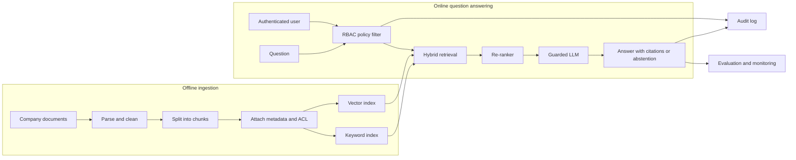
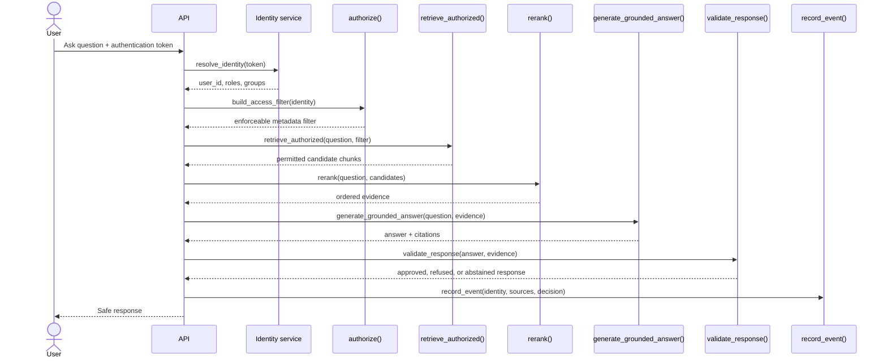

# Secure Enterprise RAG

A learning-first, production-minded Retrieval-Augmented Generation (RAG) system for answering questions over internal company documents while enforcing role-based access control (RBAC), evidence-based answers, citations, and security guardrails.

> **Current status:** Milestone 0 — architecture and security requirements. No application code or AI framework has been selected yet.

## Why this project exists

A basic RAG demo retrieves text and sends it to a language model. An enterprise system must also answer harder questions:

- Is this user allowed to retrieve this document?
- Can a malicious document manipulate the model?
- What happens when no trustworthy evidence is found?
- Can every answer be traced to its sources?
- Can we measure retrieval quality, leakage, latency, and cost?

This project will build those capabilities one layer at a time. The documentation records not only *what* we build, but *why*, how files and functions connect, common failures, rejected alternatives, and interview-ready explanations.

## First objective: security foundation

Before using an LLM, we will create a minimal permission-aware retrieval contract.

**Goal:** Given a user and a document, the system must deterministically decide whether the user may retrieve that document.

The first milestone will define:

1. Users and identities
2. Roles and groups
3. Document classifications
4. Access-control metadata attached to every document chunk
5. Default-deny authorization rules
6. Tests proving that unauthorized content is never returned

**Acceptance example**

```text
User:     engineer@example.com
Role:     engineering
Question: "What are the executive salary bands?"

Expected retrieval result: zero HR/Finance-restricted chunks
Expected response: safe refusal or access-request guidance
Expected audit event: authorization denial recorded without exposing document text
```

This comes first because an LLM instruction such as “do not reveal confidential information” is not a security boundary. Unauthorized text must be filtered out before it reaches the model.

## System overview



## The two pipelines

### 1. Ingestion pipeline

The ingestion pipeline runs when documents are added or changed.

```text
Source → parser → cleaner → chunker → metadata/ACL enrichment → embeddings → indexes
```

- A **parser** extracts text and structure from files such as PDFs or Markdown.
- A **chunker** divides a large document into passages small enough to retrieve and send to a model.
- **Metadata** describes a chunk: source, owner, department, version, and classification.
- An **ACL** (Access Control List) states which users, roles, or groups may access it.
- An **embedding** is a numeric representation used for similarity search.
- The **vector index** supports meaning-based search.
- The **keyword index** preserves exact matches such as names, product codes, and error IDs.

### 2. Query pipeline

The query pipeline runs for every user question.

```text
Identity → authorization filter → hybrid search → re-ranking → context building
         → guarded generation → citation validation → response → audit/evaluation
```

The authorization filter is applied during retrieval—not after generation—so forbidden chunks never enter the model context.

## Planned layers

| Milestone | Layer | Learning outcome | Deliverable |
|---:|---|---|---|
| 0 | Architecture | Understand the complete system and threat boundaries | This README and decision log |
| 1 | RBAC foundation | Model users, roles, documents, and default-deny policies | Authorization module and tests |
| 2 | Ingestion | Parse, clean, chunk, and enrich documents | Repeatable ingestion pipeline |
| 3 | Search | Compare vector, keyword, and hybrid retrieval | Permission-aware retriever |
| 4 | Re-ranking | Improve the ordering of retrieved evidence | Re-ranker with measurable gains |
| 5 | Generation | Produce grounded answers with citations | RAG answer service |
| 6 | Guardrails | Resist injection, leakage, and unsupported answers | Input, retrieval, and output checks |
| 7 | Evaluation | Measure retrieval and answer quality | Automated evaluation dataset and report |
| 8 | API and UI | Expose the system safely to users | Authenticated API and small client |
| 9 | Operations | Make the system reproducible and observable | Docker Compose, logs, metrics, CI |
| 10 | Deployment | Demonstrate a production path | Cloud deployment; Kubernetes optional |

## Technology decision status

No major library is considered “used” until it appears in working, tested code.

| Area | Current decision | Why |
|---|---|---|
| Language | Python (planned) | Strong ecosystem for RAG, evaluation, APIs, and data processing |
| API | FastAPI (planned) | Typed request models, OpenAPI documentation, and async support |
| Relational data | PostgreSQL (planned) | Users, roles, document metadata, and audit records need relational integrity |
| Vector search | Qdrant or PostgreSQL/pgvector (evaluation pending) | Both support metadata filtering needed for RBAC |
| Keyword search | OpenSearch or PostgreSQL full-text search (evaluation pending) | Choice depends on operational complexity and retrieval quality |
| RAG orchestration | Direct Python first; LangChain or LlamaIndex only if justified | Learning core mechanics prevents framework abstractions from hiding the pipeline |
| Guardrails | Custom deterministic checks first; NeMo Guardrails evaluation later | Authorization must remain application logic, not prompt logic |
| Evaluation | Ragas plus custom security tests (planned) | Generic RAG metrics do not prove permission isolation |
| Local infrastructure | Docker Compose (planned) | Reproducible databases and services with low setup cost |
| Cluster orchestration | Kubernetes excluded from early milestones | It adds deployment complexity before product behavior is proven |

## Included and deliberately excluded

### Included in the core build

- RBAC and document-level/chunk-level authorization
- Hybrid retrieval and re-ranking
- Grounded answers with citations and abstention
- Prompt-injection and data-leakage defenses
- Audit logging without sensitive-content leakage
- Automated retrieval, generation, and security evaluation
- Docker-based reproducible local development

### Excluded initially

- **Kubernetes:** useful at scale, but unnecessary before one deployable service works.
- **Fine-tuning:** RAG should solve changing private knowledge without retraining the model.
- **Autonomous agents:** tool-using agents enlarge the attack surface and are not required for the initial knowledge assistant.
- **Many document formats:** we will make one or two formats reliable before adding connectors.
- **Framework-heavy abstractions:** we will implement the smallest clear pipeline before adopting LangChain or LlamaIndex.

Exclusion does not always mean permanent rejection. It means the technology does not yet solve a demonstrated requirement.

## Planned repository structure

```text
secure-enterprise-rag/
├── README.md                    # Living project guide and build history
├── docs/                        # Deeper concepts, decisions, and troubleshooting
├── src/
│   └── secure_rag/
│       ├── auth/                # Identity, roles, policy evaluation
│       ├── ingestion/           # Parsing, cleaning, chunking, metadata
│       ├── retrieval/           # Vector, keyword, hybrid search, re-ranking
│       ├── generation/          # Context assembly, prompts, citations
│       ├── guardrails/          # Injection, leakage, and output checks
│       ├── evaluation/          # Quality and security metrics
│       └── api/                 # HTTP endpoints and dependency wiring
├── tests/                       # Unit, integration, security, and evaluation tests
├── data/                        # Synthetic demo documents only
└── docker-compose.yml           # Local infrastructure (added later)
```

## How future functions will connect

Names below describe the intended interfaces; they are not implemented yet.



Each implementation milestone will replace these planned names with links to the actual files, functions, tests, inputs, outputs, and failure behavior.

## Failure-oriented learning checklist

When RAG “does not work,” identify the failing layer instead of immediately changing the prompt.

| Symptom | Likely layer | Example causes |
|---|---|---|
| No documents found | Ingestion/indexing | Missing source, parsing failure, stale index |
| Relevant document exists but is not retrieved | Retrieval | Poor chunks, weak embedding, vocabulary mismatch, threshold too strict |
| Correct chunk appears too low | Ranking | Weak fusion weights or re-ranker |
| Authorized user sees nothing | Authorization | Incorrect role mapping or metadata filter |
| Unauthorized user sees a sensitive chunk | Security-critical authorization failure | Missing ACL, filter bypass, unsafe cache key |
| Evidence is correct but answer is wrong | Generation | Bad context construction, ambiguous prompt, model limitation |
| Answer invents unsupported facts | Grounding/guardrails | No abstention rule or citation validation |
| Good answer is slow or expensive | Operations | Excessive candidates, oversized chunks, repeated embeddings |

## Build journal

### 2026-10-18 — Repository initialization

- Cloned the empty GitHub repository.
- Defined the project purpose and security-first architecture.
- Selected permission modeling as the first implementation objective.
- Documented planned technologies without claiming they are already implemented.
- Deferred Kubernetes, fine-tuning, autonomous agents, and premature framework adoption.

## Documentation rule

Every meaningful implementation should update this README or a linked document with:

1. What changed
2. Why it was needed
3. Libraries introduced and why
4. Alternatives rejected or deferred
5. File/function connections
6. Tests performed
7. Known failure modes and troubleshooting steps

This keeps the repository useful as both a working project and an interview study guide.

